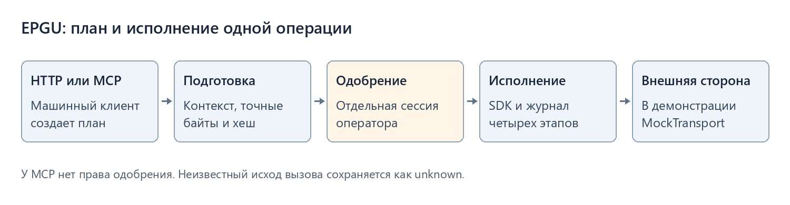

# Запрос к Госуслугам ушел, ответ потерялся. Как я проверяю оркестратор API через HTTP и MCP

Успешный POST обычно показывать легко. Гораздо интереснее момент, когда запрос уже отправлен, а ответ не пришел. Повторить его? Возможно, первая попытка успела создать заявление. Считать операцию неуспешной? Это тоже пока неизвестно.

В открытом проекте [epgu](https://github.com/yellow444/epgu) я довожу слой, который хранит подготовленную операцию, ее одобрение, ход исполнения и результат. Снаружи к нему можно обратиться через HTTP или MCP. Внутри используется один backend и общий механизм исполнения.

Для проверки выбран запрос ФССП `60010153` о наличии исполнительного производства. Полный цикл от XML до скачанного документа воспроизводится на mocks: внешние ответы Госуслуг заменены тестовым транспортом. Это главное ограничение примера. Живую проверку подключения расскажу отдельно ближе к концу.

## Что приходится хранить между вызовами

Заявка здесь не равна одному HTTP-запросу. Сначала нужно подготовить документы, затем получить номер, подставить его в отправляемые данные, передать архив, узнать состояние и скачать результат.

Если реализовать это одной функцией, после сбоя придется выяснять, до какой строки она дошла. Поэтому в оркестраторе есть план и журнал его шагов.

Подготовка фиксирует контекст, возможность, целевой объект и точные байты полезной нагрузки. У плана есть хеш. Одобряется именно этот вариант данных. Когда вызывающий код меняет форму, старое одобрение не должно превращаться в разрешение отправить новую.

Путь выглядит так: подготовить план, посмотреть его содержимое, одобрить хеш, запустить исполнение, отдельно прочитать результат. Предпросмотр здесь нужен по практической причине: фраза «подать запрос ФССП» не показывает, какие данные уйдут наружу.



## Почему MCP не должен сам одобрять план

Машинный ключ в примере умеет подготовить и исполнить операцию. Право одобрения у него отсутствует. Это делает отдельная административная сессия, которая получает точное содержимое плана и проверяет хеш.

В демонстрации эту роль выполняет тестовый сценарий. Живого человека в цикле нет, и называть это приемкой настоящего пользовательского одобрения было бы неправильно. Но граница полномочий проверяется: попытка исполнить неподтвержденный план отклоняется, инструмента `plan_approve` у MCP нет.

MCP в этом проекте служит еще одним клиентом backend. Он не создает собственную базу планов и не заменяет проверку доступа рассуждением языковой модели. Модель может выбрать инструмент и заполнить аргументы; решение о допустимости операции принимает обычный код.

Для воспроизведения полного mock-цикла языковая модель вообще не нужна. Так проще проверить протокол и результат независимо от качества ее ответа.

## Что в примере настоящее, а что подменено

Используются настоящий backend, вход в нашу локальную установку, временный ключ интеграции, построитель XML, проверка бизнес-запроса по XSD, ZIP и Python SDK. Через тот же механизм исполняются этапы резервирования, отправки, чтения состояния и скачивания.

Подменена внешняя сторона. `httpx.MockTransport` принимает ожидаемые обращения SDK и возвращает фиксированные ответы. Сетевых соединений с ЕПГУ этот сценарий не открывает. Форма разрешена только одна, синтетическая; произвольные персональные данные и другие услуги в эту демонстрацию не подставляются.

Скачанный `mock-result.xml` тоже придуман нами для проверки. Он занимает 98 байт и не является официальным форматом ответа ФССП. Его назначение: проверить, что документ прошел всю цепочку и его содержимое совпало на выходе.

Такое разделение позволяет ответить на конкретный вопрос: работает ли наш код на ожидаемом контракте? Оно не отвечает на другой вопрос: примет ли заявление реальный TEST или PROD.

## Два входа в один цикл

Сначала сценарий проходит по HTTP. Создает план, проверяет запрет исполнения без одобрения, одобряет через отдельную сессию, запускает и читает сохраненный результат.

Потом запускается отдельный процесс MCP со стандартными потоками ввода и вывода. Через `plan_prepare`, `plan_execute` и `plan_get` он обращается к тому же локальному backend. Одобрение снова выполняется снаружи MCP.

В обоих случаях журнал должен показать четыре обращения внешнего транспорта:

| Этап | Что проверяется |
| --- | --- |
| reserve | Получен ожидаемый номер заявления |
| push | Отправлен архив с согласованными документами |
| status | Получено ожидаемое конечное состояние |
| download | Скачан и проверен демонстрационный документ |

Успешный повтор `execute` возвращает уже сохраненный результат. В демонстрации число обращений к внешнему mock-транспорту при этом не растет. Это проверенное поведение нашего оркестратора, а не заявление о поддержке exactly-once внешним сервером.

## Самая важная ошибка: неизвестный исход

Обычно в интерфейсе хочется оставить два состояния: получилось или не получилось. Для сетевой операции их недостаточно.

Можно отправить архив, а затем потерять ответ. Ведомственный сервер мог принять документы, пока клиент ждал. Автоматический повтор подачи в такой ситуации способен создать вторую операцию.

Поэтому при потере ответа план получает `unknown`. В журнале остаются известные завершенные шаги и начатый вызов с неизвестным исходом. Оркестратор сам не объявляет его ни успешным, ни безопасным для повтора.

Для проверки этого поведения в mock-сценарии предусмотрены отказы на каждом из четырех этапов. Отдельно проверяются неверный номер, неправильный документ результата и промежуточный ведомственный статус.

Если услуга еще обрабатывается, этот ограниченный пример останавливается без итогового документа. Долгий опрос и продолжение обработки позже здесь пока не реализованы. Одного успешного mock-цикла для обещания полноценного диспетчера реальных заявлений недостаточно.

## Как повторить пример

Пример опубликован в коммите [`997c24c`](https://github.com/yellow444/epgu/tree/997c24c9bc88baaf2d511547ee86e0fdfe55b217). Ниже команды для PowerShell и отдельного виртуального окружения Python. Начните в новой папке без другой копии epgu. При подготовке текста использовался Python 3.13.15.

```powershell
git clone https://github.com/yellow444/epgu.git
cd epgu
git checkout 997c24c
cd project/api-gosuslugi-backend
python -m venv .venv
.\.venv\Scripts\python -m pip install -r requirements.txt -e "../mcp-server[operations]"
$demoOutput = Join-Path $env:TEMP ('epgu-fssp-' + [guid]::NewGuid().ToString('N'))
.\.venv\Scripts\python ../examples/fssp_mock_cycle.py --output "$demoOutput"
```

Используйте пустой каталог вне Git. Собственная база, синтетический пользователь и временный ключ будут созданы там. Скрипт сам запускает backend на свободном loopback-порту, проходит HTTP и stdio MCP, отзывает ключ, удаляет файл секрета и останавливает свой сервер. Действующая установка приложения ему не нужна.

В глобальном Python у меня обнаружилась другая версия MCP SDK, с которой этот пример не стартовал. Поэтому виртуальное окружение и установка зависимостей здесь существенны: «пакет mcp уже стоит» еще не означает совместимый интерфейс клиента.

После выполнения в каталоге остаются `receipt.json`, синтетическая база и папки `http/` и `mcp/`. В них находятся созданные XML и результат. Сокращенный итог выглядит так:

```json
{
  "mock_only": true,
  "service": "60010153",
  "runs": {
    "http": {"status": "succeeded", "document_bytes": 98},
    "mcp": {"status": "succeeded", "document_bytes": 98}
  },
  "integration_revoked": true,
  "credential_removed": true,
  "backend_stopped": true
}
```

Это сокращение полей, а не отдельный полный формат квитанции. Для сравнения результатов есть SHA-256 документа; в двух путях он совпадает. [Описание сценария и отказов](https://github.com/yellow444/epgu/blob/997c24c9bc88baaf2d511547ee86e0fdfe55b217/project/epgu/FSSP_MOCK_CYCLE.md) находится рядом с кодом.

## Что произошло на живом TEST

В проверке 20 ноября 2026 года ключ нашей ИС позволил получить токен, с которым прошло чтение списка заявлений и справочника ОКАТО. Список заявлений был пустым, справочник вернул элемент. Проверки выполнялись без браузерных cookies, с проверкой TLS.

При этом создание заявления ФССП получило HTTP 403 `access_denied_system`. Отдельная проверка резервирования по 21 услуге каталога дала 20 таких отказов и один `service_not_found`. Номера заявлений не были выданы, документы не отправлялись.

Эта проверка по каталогу не означает, что в проекте реализованы 21 построитель и 21 полный цикл. Она проверяет определенный внешний этап: допуск системы к резервированию номера.

Из ответа 403 нельзя достоверно выбрать между отсутствующим разрешением и ошибкой настройки шлюза. Вопрос остается у оператора. Наш локальный журнал позволяет показать, каким методом дошли до отказа, но не объясняет внутреннее решение чужого сервера.

В этом проверенном срезе подтверждены авторизация и чтение. Успешной подачи реального заявления пока нет.

## Где это можно использовать после демонстрации

Для 1С возможная точка входа выглядит так: учетная система формирует задачу проверки, оператор смотрит данные плана и одобряет конкретный запрос. После исполнения результат сохраняется рядом с задачей. Отдельный адаптер должен определить проверенную связь с документом; готовая интеграция с типовой конфигурацией пока не заявлена.

Для Битрикс24 можно начать с отдельного смарт-процесса входящих: карточка, ответственный, событие для подготовки плана. Для n8n или ServiceDesk входом служит webhook или собственный клиент API. Ни одна из этих систем не должна автоматически получать право одобрять свои запросы только потому, что умеет вызвать HTTP-метод.

Есть и отдельный [EPGU Bell 0.2.0-rc.4](https://github.com/yellow444/epgu-bell/releases/tag/v0.2.0-rc.4), который дает JSON уведомлений сайта. Версия rc.4 относится к читателю; пример оркестратора выше закреплен за своим опубликованным коммитом. Его запись можно положить в такую входящую очередь. Она остается поводом для проверки, а не командой подать заявление. В этом выпуске опубликованы [Python-клиент импорта](https://github.com/yellow444/epgu-bell/blob/v0.2.0-rc.4/examples/integrations/import_notifications.py), [BSL-пример 1С](https://github.com/yellow444/epgu-bell/blob/v0.2.0-rc.4/examples/1c/BellReader.bsl) и [генератор заготовок для CRM, webhook и краткого оповещения](https://github.com/yellow444/epgu-bell/blob/v0.2.0-rc.4/examples/automation/prepare_actions.py). Генератор проверен на синтетических данных; реальные внешние действия не выполняются. На двух уведомлениях он создает шесть заготовок, повтор добавляет ноль. [Руководство подключения](https://github.com/yellow444/epgu-bell/blob/v0.2.0-rc.4/docs/AUTOMATION_RECIPES.md) описывает настройки и ограничения каждого пути. Эти клиентские примеры не содержат реализацию закрытого сборщика.

Источники сообщений здесь различаются: в основном ядре есть работа с API Госпочты, а Bell получает уведомления сайта. Эти каналы нельзя считать взаимозаменяемыми или обещать одинаковый охват. Сам факт выделения Bell в отдельный продукт не означает, что новый сборщик уже встроен в основную установку.

Первая проверяемая цепочка для такого подключения: принять синтетическое событие дважды, сохранить одну карточку, подготовить mock-план и получить результат через API/MCP. Живое подключение конкретной CRM, учетной системы и услуги потребует отдельной приемки. Сам генератор заготовок не выполняет ни одного из внешних шагов этой цепочки.

## Справочник и границы открытой части

В проекте есть справочник подключения со схемами, источниками и карточкой разбора ситуации. В ней различаются «да», «нет» и «не знаю». Вывод помечается `caller_reported`: это обработка отметок пользователя, а не скрытая проверка его кабинета.

Справочные методы доступны через HTTP и MCP. Обычный MCP-сервер по умолчанию запускается в профиле знаний. Исполняющий сервер mock-примера включается отдельно и не превращает справочник в разрешение на внешние операции.

Открытое ядро распространяется по AGPL. Закрытые дополнения для нескольких организаций, браузерной автоматизации и установленный приватный runtime в этот пример не входят. Текущую локальную установку нельзя без дополнительной работы выдавать за многопользовательский SaaS.

Для меня ближайшая полезная проверка теперь очень конкретная: получить внешний допуск и пройти тот же цикл в TEST до реального результата. До этого момента уже можно воспроизводить ошибки транспорта, проверять свои HTTP- и MCP-клиенты и изучать устройство плана на работающем примере.
